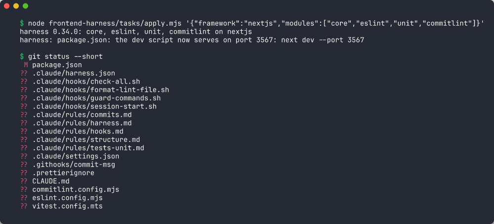

# frontend-harness

[](https://github.com/dvasyliev/frontend-harness/actions/workflows/ci.yml)
[](plugins/frontend-harness/CHANGELOG.md)
[](LICENSE)

Claude Code plugin that sets up hooks, rules and checks so Claude writes code that fits your React or Next.js project

[Claude Code](https://docs.claude.com/en/docs/claude-code/overview) writes code fast. But it often says "done" when the code still has errors. Then you find them yourself and ask it to fix them. Again and again.

frontend-harness makes Claude check its own work. After every change, it checks the code. If something is broken, Claude fixes it before it tells you it is done. You get working code, not a list of things to clean up.

## The problems it solves

| Without it | With it |
|---|---|
| Claude says "done", but the code has errors or the tests fail. | Before Claude says "done", the checks run. If one fails, Claude is sent back to fix it. |
| You fix the formatting and code style after Claude. | Each file is formatted and checked right after Claude changes it. |
| You repeat the same instructions in every chat. | The project's rules are written down once. Claude reads them when it works on those files. |
| Claude adds a new library when the project already has one for that job. | The project has a list: one library for each job. Claude uses it. |
| The code slowly gets messy: copied code, unused code, very long files. | Tools find this on every change, and Claude cleans it up. |
| Claude runs a risky git command, like a force push. | Risky commands are blocked. |
| A bad commit or a leaked password gets pushed. | Git checks the commit message and looks for passwords before every commit. |
| Setting all this up by hand takes days. | One command sets it up. Another one updates it later. |

## How it works

You ask Claude for a change. Then, every time:

1. Claude edits a file.
2. The file is formatted and checked at once. Claude sees any errors and fixes them.
3. When Claude wants to stop, all the checks run: types, code style, tests and more.
4. If a check fails, Claude is sent back to fix it before it finishes.

All of this lives in your project's own files (the `.claude/` and `.githooks/` folders, config files and `package.json`). So it works even without the plugin, and everyone who clones the project gets it too.

**Words used here:**

- **Harness:** the whole set of checks, rules and scripts that keeps Claude on track.
- **Hook:** a small script that runs on its own at a set moment, for example right after Claude edits a file.
- **Module:** one part of the harness you can turn on or off, for example "unit tests".

## Table of Contents

- [Install](#install)
- [Usage](#usage)
- [Modules](#modules)
- [Contributing](#contributing)
- [License](#license)

## Install

You need:

- [Claude Code](https://docs.claude.com/en/docs/claude-code/overview)
- [Node.js](https://nodejs.org) (it comes with npm)
- git
- a React (Vite) or Next.js project

Run these two commands in your project's folder:

```bash
claude plugin marketplace add dvasyliev/frontend-harness
claude plugin install frontend-harness@frontend-harness --scope local
```

`--scope local` turns the plugin on only for you, only in this project. Use `--scope project` to turn it on for everyone on the project, or `--scope user` to turn it on in all your projects.

## Usage

Open Claude Code in your project and type:

```
/frontend-harness:setup
```

Claude asks you a few questions: which framework you use and which modules you want. Then it adds the files, keeps what your project already had, runs the checks and makes a commit.

Here are the files it added to a Next.js project with four modules:



Later, you can:

| To | Type |
|---|---|
| Add or remove modules | `/frontend-harness:setup`, or just ask: "add e2e tests" |
| Get the newest version of the harness, without losing your own changes | `/frontend-harness:update` |
| Pick the libraries for forms, data, dates and so on | `/frontend-harness:libraries` |

More commands, how to turn off one check, and how to remove the plugin: [plugin guide](plugins/frontend-harness/README.md).

## Modules

Pick only what you need. `core` is always on.

| Module | What it does for you |
|---|---|
| `core` | Formats and checks each file Claude edits. Runs all checks before Claude finishes. Blocks risky commands. Checks types (TypeScript). |
| `feature-workflow` | Claude works in steps: describe the feature, plan it, write tests first, check it in the browser. |
| `eslint` or `oxlint` | Finds code mistakes and bad patterns. Also stops files from getting too long. |
| `knip` | Finds code and packages nobody uses. |
| `jscpd` | Finds copied code. |
| `tailwind` | Keeps Tailwind classes in the same order everywhere. |
| `unit` | Runs unit tests (Vitest). |
| `e2e` | Runs browser tests (Playwright) and checks pages for accessibility problems before you push. |
| `commitlint` | Checks that commit messages follow one format. |
| `pre-commit` | Before each commit, looks for passwords and keys and checks the changed files. |
| `sync-deps` | Runs `npm install` for you after a pull that changed packages. |
| `best-practices` | Gives Claude Vercel's React and Next.js guides. |
| `context7` | Lets Claude read the current docs of your libraries, not old ones from memory. |
| `libraries` | One chosen library for each job, so Claude does not add new ones. |
| `next-docs` | Gives Claude the docs of your exact Next.js version. |
| `page-speed` | Rules for fast pages, a browser tool to measure them, and a size limit for your code bundle (React). |

Full details for each module: [plugin guide](plugins/frontend-harness/README.md#modules).

<!-- COURSES:START -->
# All My Courses

#### Agentic AI Courses

<p>
  <a href="https://go.dvasyliev.com/harness-engineering"></a>
  <a href="https://go.dvasyliev.com/openclaw"></a>
  <a href="https://go.dvasyliev.com/evaluating-ai-code"></a>
</p>

#### AI Tools Courses

<p>
  <a href="https://go.dvasyliev.com/claude-code"></a>
  <a href="https://go.dvasyliev.com/copilot"></a>
  <a href="https://go.dvasyliev.com/cursor"></a>
  <a href="https://go.dvasyliev.com/windsurf"></a>
  <a href="https://go.dvasyliev.com/antigravity"></a>
</p>

#### AI Certifications Courses

<p>
  <a href="https://go.dvasyliev.com/cca-f"></a>
  <a href="https://go.dvasyliev.com/gh300"></a>
  <a href="https://go.dvasyliev.com/gh300-practice"></a>
</p>

#### Vibe Coding Courses

<p>
  <a href="https://go.dvasyliev.com/v0"></a>
  <a href="https://go.dvasyliev.com/lovable"></a>
</p>

#### Front-End Courses

<p>
  <a href="https://go.dvasyliev.com/react"></a>
  <a href="https://go.dvasyliev.com/ai-chatbot"></a>
</p>

#### Full-Stack Courses

<p>
  <a href="https://go.dvasyliev.com/nextjs"></a>
  <a href="https://go.dvasyliev.com/nodejs"></a>
</p>

#### Other Courses

<p>
  <a href="https://go.dvasyliev.com/agentkit"></a>
  <a href="https://go.dvasyliev.com/chatgpt"></a>
</p>

[All courses →](https://www.dvasyliev.com/courses)
<!-- COURSES:END -->

## Contributing

Have a question, found a bug or have an idea? [Open an issue](https://github.com/dvasyliev/frontend-harness/issues). Pull requests are welcome.

After you clone the repo, run `npm install` once. It turns on git checks for your commits. Commit messages follow [Conventional Commits](https://www.conventionalcommits.org), for example `fix(frontend-harness): ...`. Versions and the changelog are made from these messages, so do not change them by hand. Commit rules: [CLAUDE.md](CLAUDE.md). How the plugin is built: [plugin's CLAUDE.md](plugins/frontend-harness/CLAUDE.md).

## License

[MIT](LICENSE) © Dmytro Vasyliev
